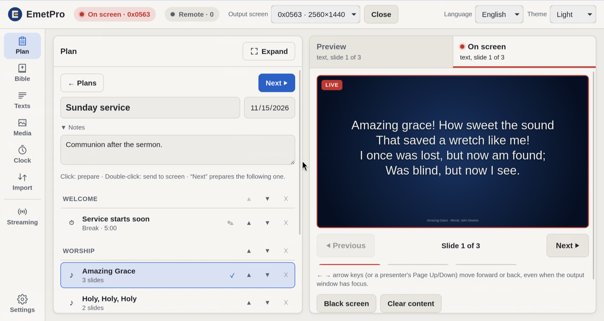

<p align="center">
  <picture>
    <source media="(prefers-color-scheme: dark)" srcset="docs/assets/logo-dark.png">
    
  </picture>
</p>

<p align="center"><b>Free, open-source projection and live-streaming software for churches.</b><br>
Windows · macOS · Linux — English, Spanish and Italian</p>

> **EmetPro was called Selah until version 0.8.2.** Many Bible and devotional apps already use the name "Selah", so the project was renamed to have a name of its own. *Emet* (אמת) is Hebrew for "truth, faithfulness". The "Pro" does not mean a paid edition: EmetPro is and will remain free.
>
> It is the same app, and your data comes with it. **If you have Selah installed:** install EmetPro and open it once. It copies your Bibles, lyrics, plans, media, settings and remote-control pairing from Selah, then works on its own copy. Once you have checked that everything is there, you can uninstall Selah. Its data folder is left untouched as a backup. Lyrics files exported from Selah (`.selah`) still import.



## What it does

EmetPro runs on the computer connected to the church projector or TV. One window is the **console**, where the operator prepares content; a second window is the **output**, full screen on the monitor you choose. Nothing reaches the screen until you send it: what you prepare appears in a preview first.

- **Bible:** browse book → chapter → verse, or search by reference ("John 3:16", "Ps 23") or by words. Show two versions side by side. The version's copyright is always shown on screen. Use the arrow keys to move through verses.
- **Lyrics and texts:** a lyrics library with slides, backgrounds (image or GIF) and fonts; free text for announcements. Import playlists from Holyrics (`.hpls`), and export your library to a single `.emetpro` file for backup or another computer.
- **Media:** images, videos, PDFs and presentations (PowerPoint, Impress, Keynote), one by one or by folder. Presentations are converted with LibreOffice; if it isn't installed, EmetPro can download a private copy that you can remove later.
- **Service plans:** prepare the order of service in advance (sections, songs, Bible passages, media and pauses), then step through it with "Next".
- **Clock and timer:** show the time, or a countdown with a title that turns red when time runs out.
- **Screen style:** automatic text sizing, alignment, position, background color or image, and your church logo as a watermark. Black out the screen and come back to what was there.
- **Remote control from a phone:** pair a phone or tablet with a QR code on the same Wi-Fi network. Search and show verses, move through slides and pages, see what is on screen, and draw on it with a whiteboard (underline a verse, mark a slide, or use blank sheets). No app to install: it runs in the phone's browser.
- **Live streaming with OBS:** EmetPro sets up OBS for you (WebSocket, scenes for camera, camera with lower third, and a waiting screen), sends the verse or lyric on screen as a lower third, and starts or stops the stream. OBS does the streaming, so closing EmetPro doesn't cut it.
- Light, dark or system theme. Everything is stored locally on the computer; no account, no internet needed (except to download LibreOffice or to stream).

## Download

Installers for Windows (`.msi`, `.exe`), macOS (universal `.dmg`) and Linux (`.deb`, `.rpm`, `.AppImage`) are on the [Releases](https://github.com/joseMChavez/selah-app/releases) page.

The installers are not signed yet, so the system warns the first time you open them:
- **Windows:** SmartScreen says "Windows protected your PC" → "More info" → "Run anyway".
- **macOS:** right-click EmetPro in Applications → "Open" → "Open". If it says the app is damaged: `xattr -cr /Applications/EmetPro.app`.
- **Linux:** make the AppImage executable (`chmod +x EmetPro_*.AppImage`).

EmetPro is still a pre-release (0.x): it is used in real services, but expect changes. It is developed and tested mostly on Linux; Windows and macOS builds are tested less often.

## Bibles

Bibles are **not** included in the downloads, because many translations are copyrighted. Import them from the app (Bible → "+") as XML files in the [Beblia format](https://github.com/Beblia/Holy-Bible-XML-Format), which covers hundreds of versions and languages. Make sure you are allowed to use the translations you import.

## Building from source

Requirements: [Node.js](https://nodejs.org/), [Rust](https://www.rust-lang.org/tools/install) and the [Tauri prerequisites](https://tauri.app/start/prerequisites/) for your system. On Linux, GStreamer with gst-libav is needed for video.

```sh
cd app
npm install
npm run tauri dev      # run in development mode
npm run tauri build    # build installers into app/src-tauri/target/release/bundle/
```

Built with [Tauri 2](https://tauri.app/) (Rust) and [SvelteKit](https://svelte.dev/) (Svelte 5, TypeScript), with SQLite for local storage. To bundle Bibles in a local build, put Beblia XML files in `app/src-tauri/resources/bibles/<language>/` (they are ignored by git).

Releasing a version: [docs/RELEASES.md](docs/RELEASES.md).

## Documentation

The project's design notes are written in Spanish for now: [decisions log](docs/DECISIONS.md), [architecture](docs/ARQUITECTURA.md) and [streaming tests](docs/PHASE2-TESTS.md). Code comments are also in Spanish. Issues and pull requests in English are welcome.

## License

[GPL-3.0](LICENSE). Third-party code reused in the project is listed in [docs/REUSE.md](docs/REUSE.md).
